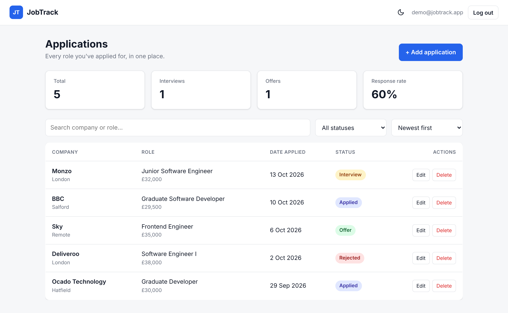

# JobTrack

A clean, responsive web app for tracking job applications: built with **HTML, CSS and vanilla JavaScript**, using **Firebase Authentication** and **Cloud Firestore** for secure cloud storage.

**Live demo:** _add your link here_

<!-- Add a screenshot once deployed: save it as screenshot.png in this folder, then replace this line with:  -->

## Features

- **User accounts:** sign up / sign in with email and password, or Google
- **Full CRUD:** add, view, edit and delete applications
- **Quick status updates:** change status (Applied → Interview → Offer / Rejected) straight from the table
- **Search, filter and sort** by company, role, status and date
- **Live statistics:** total applications, interviews, offers and response rate
- **Real-time sync:** data updates instantly across devices (Firestore listeners)
- **Secure:** Firestore security rules ensure each user can only access their own data; user input is escaped to prevent XSS
- **Responsive:** table switches to cards on mobile
- **Dark mode**

## Tech stack

| Area | Technology |
|---|---|
| Front end | HTML5, CSS3 (custom properties, grid, flexbox), JavaScript (ES modules) |
| Auth | Firebase Authentication |
| Database | Cloud Firestore |
| Hosting | Firebase Hosting |

## Project structure

```
jobtrack/
├── index.html          # Markup: auth screen, dashboard, modal
├── style.css           # Styles, theming and responsive layout
├── app.js              # App logic: auth, Firestore CRUD, rendering
├── firebase-config.js  # Firebase project settings
├── firestore.rules     # Database security rules
└── firebase.json       # Firebase Hosting / Firestore config
```

## Run it locally

1. **Create a Firebase project** at [console.firebase.google.com](https://console.firebase.google.com).
2. **Add a Web app** (Project settings → Your apps → `</>`), then copy the config into `firebase-config.js`.
3. **Enable Authentication:** Build → Authentication → Sign-in method → enable **Email/Password** and **Google**.
4. **Create a Firestore database:** Build → Firestore Database → Create database (production mode).
5. **Add the security rules:** paste the contents of `firestore.rules` into Firestore → Rules → Publish.
6. **Serve the folder** (ES modules need a server, not `file://`). In VS Code, use the **Live Server** extension, or run:
   ```bash
   npx serve .
   ```

## Deploy

```bash
npm install -g firebase-tools
firebase login
firebase init      # choose Hosting + Firestore, use existing project, public dir "."
firebase deploy
```

## What I learned

- Structuring a vanilla JS app without a framework (state, rendering, event delegation)
- Integrating a backend-as-a-service: authentication and a NoSQL database
- Writing security rules to protect user data
- Building accessible, responsive UI with modern CSS

## Author

**Prince Kay**, BSc (Hons) Software Engineering, Coventry University
